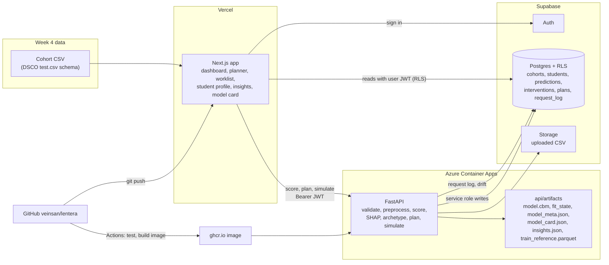

# Architecture: Lentera

Steps marked Done in `TODO.md` are implemented; everything else below is planned. The source model and its evaluation live in the DSCO workspace (`C:\Users\riant\Projects\dsco`), referred to here as `dsco/`.

## Technical Stack

| Area | Choice | Status |
| --- | --- | --- |
| Frontend | Next.js 16.4.6 (App Router, TypeScript, Cache Components), Tailwind CSS 4, shadcn/ui on Base UI, Recharts | Agreed; versions in `CLAUDE.md` |
| Frontend package manager | pnpm | Agreed |
| Backend | FastAPI on Python 3.13 | Agreed. 3.13 because Smart App Control blocks the uv-managed 3.12 on the owner's machine. |
| ML libraries | catboost 1.2.10, pandas 3.1.1, numpy 2.5.4, scikit-learn 1.9.1. SHAP values come from CatBoost itself. | Done. Matches `dsco/outputs/audit/requirements-lock.txt` except pandas 3.1.1; parity check passed. |
| Python package manager | uv | In use for `api/` |
| Database and auth | Supabase (Postgres, Auth, row level security, Storage); asymmetric ES256 JWT signing keys and `sb_publishable_`/`sb_secret_` API keys | Done for schema and auth |
| Frontend hosting | Vercel | Agreed |
| API hosting | Docker image built by GitHub Actions, pushed to GitHub Container Registry (`ghcr.io`), run on Azure Container Apps | Agreed: Azure. Container Apps over App Service is a proposal awaiting the owner's confirmation. |
| Model artifact storage | Committed to the GitHub repository under `api/artifacts/` | Agreed |
| Source control | GitHub, private repository `veinsan/lentera` | Agreed |

Pending: the owner confirms the Azure subscription type (for example, Azure for Students), which decides the Container Apps region and spending limit.

## System Structure



### Components

- **Next.js app (`web/`).** Renders every page. Reads cohort, student, prediction, intervention, and plan rows from Supabase with the signed-in user's session, so row level security applies. Calls the API for work that needs the model: cohort scoring, what-if, counterfactual, capacity planning, and drift. Writes intervention records directly to Supabase.
- **FastAPI service (`api/`).** Loads the model and fit state once at startup. Verifies the Supabase access token on each request with the project's JWKS endpoint and reads the user's role from `profiles`. Writes scored cohorts and the request log to Supabase with the service role key.
- **Preprocessing (`api/app/pipeline/`).** A port of `features()` and `FoldFeatures` from `dsco/src/train_only.py` in `clean_rank` mode: category normalization, the `GGG` to `M07` repair and the M05/P12/261-day repair, placeholder activity detection (`interaction_volume` not equal to the sum of the four weekly columns), score and per-assessment placeholders set to missing, ratio and recency features, and seven cohort percentile ranks computed against the training distribution with a global fallback for unseen cohorts. The fit state (category levels and sorted rank references per cohort) is saved from training and loaded at inference, so a single uploaded row is ranked the same way as in the submitted model.
- **Explanation (`api/app/explain.py`).** CatBoost SHAP values (`get_feature_importance(type="ShapValues")`). The 77 model features are summed into 14 signals, which keeps SHAP additive: 9 actionable (submission, timeliness, score, active days, recency, volume, week 4 activity, breadth, LMS record) and 5 context (course, registration, workload, prior attempts, demographics). For a row with the placeholder activity block, the five activity signals fold into the LMS record signal. Each signal has an Indonesian sentence built from the student's raw values.
- **Rules (`api/app/rules.py`).** Tier, uncertain band, archetype, playbook, and Indonesian message templates, as defined in `PRD.md` sections 5 and 5.1. Pure functions with unit tests.
- **Scenarios (`api/app/scenarios.py`).** Four actionable levers. Each lever edits raw columns and recomputes every aggregate the dataset derives from them, with formulas verified on `train.csv`: volume is the weekly sum, early and late are two-week sums, the late to early ratio is 0 when early is 0, active weeks count the non-zero weeks, per-day and per-week averages divide the volume, span is last minus first activity day, and `interaction_trend` is the least-squares slope over weeks 1 to 4. The data window ends at day 28, so activity levers act on week 4. Lever definitions, awaiting the owner's confirmation:
  - **Submit pending assessments:** only for `no_submission_by_cutoff` 1. Completion rates go to 1, `submitted_count` to at least the due count, and new submissions are on the deadline (delay 0). Every M05 and M07 row has identical submission columns (completion 0, `no_submission_by_cutoff` 0, `has_score` 0), so the lever leaves those modules unchanged.
  - **Return to activity:** for a student last active before day 28, one more active day on day 28 at the student's own interactions per active day.
  - **Week 4 activity at the cohort median:** `week4_interactions` raised to the median of not-at-risk students with a real activity block in the same cohort (`api/artifacts/scenario_reference.json`, global median for an unseen cohort).
  - **More active days:** `active_days` plus 3, capped at the days between first and last activity.

  The counterfactual tries every combination of up to three levers in one batch prediction. The model is not monotonic in every feature, and a lever raises the probability for 3.9% to 12.9% of flagged test students, so only levers that lower a student's probability on their own are offered. The result has the smallest helpful combination below 0.375 (ties go to the lowest probability), the helpful combination with the largest reduction, and the effect of each helpful lever. Rows with the placeholder activity block get an administrative check instead. On the 3,875 flagged test students: 710 have a combination below the threshold, 2,221 have only a reduction, 944 have the placeholder block; the batch takes 0.57 s.
- **Planner (`api/app/planner.py`).** Greedy allocation by value per advisor minute, where value is probability times assumed effectiveness. Zero-minute interventions are always assigned (channel `automated`); a student who does not fit is skipped and cheaper students are still tried (channel `unassigned`). The summary reports advisor and automated reach as summed probabilities and labels effectiveness-weighted totals as scenarios. The reach curve re-runs the allocation over 21 points from zero to the hours that cover every flagged student. With effectiveness 1.0 the planner fills capacity with the cheapest high-probability checks (5 and 10 minute administrative checks), so effectiveness settings decide whether calls to students with missed submissions get priority.
- **Data quality gate (`api/app/quality.py`).** Reads the CSV as text, then checks it against `api/artifacts/input_schema.json` (the 63-column `test.csv` header, numeric and categorical columns, train categories). Errors block scoring: empty file, more than 50,000 rows, missing columns, missing or duplicate ids, non-numeric values. Warnings do not: extra columns, empty cells, rates outside 0 to 1, negative counts, early/late sums that differ from the weekly columns, unknown categories. Repairs are listed with counts: GGG to M07, the M05/P12/261-day row, and relabeled categories. The report compares placeholder, no-score, and missed-submission shares with train.
- **Scoring and storage (`api/app/scoring.py`, `api/app/store.py`).** Scoring adds probability, flag, tier, uncertain band, archetype, playbook action, and reason codes, with the normalized module code (`m07` for GGG). Storage uploads the CSV to the private `cohorts` bucket, inserts the cohort, students (raw row as jsonb), and predictions in batches of 1,000 with the secret key, and removes the cohort and file if any step fails.
- **Offline artifacts (`api/scripts/`).** `train.py` trains the final model on all training rows and writes `model.cbm` and `fit_state.json`. `build_model_card.py` reads the DSCO evaluation outputs and OOF predictions and writes `model_card.json` (nested CV per seed, ablation, calibration bins, per-module, per-segment, and fairness metrics). `build_insights.py` writes `insights.json` (per-module AUC, uncertain share, graded-score share, weekly medians by outcome, and rule-based course recommendations with cutoffs AUC below 0.75, uncertain share above 0.40, at-risk rate from 0.58). `build_input_schema.py` writes `input_schema.json`. `build_reference.py` writes the training feature sample used for PSI. `seed_demo_users.py` creates the demo accounts.

### Data Model

| Table | Columns | Access |
| --- | --- | --- |
| `profiles` | `id` (auth user), `full_name`, `role` (`advisor`, `coordinator`, `admin`), `modules` (text array, lowercase codes such as `m07`) | User reads own row; admin reads and updates all |
| `cohorts` | `id`, `name`, `uploaded_by`, `uploaded_at`, `storage_path`, `n_rows`, `model_version`, `status`, `quality_report` (jsonb), `drift_report` (jsonb) | Read by all signed-in users; written by the API |
| `students` | `id`, `cohort_id`, `source_id` (CSV `id`), `code_module`, `code_presentation`, `raw` (jsonb of the CSV row) | Advisors and coordinators read rows in their modules |
| `predictions` | `student_id`, `cohort_id`, `code_module` (copied for RLS and dashboard queries), `model_version`, `probability`, `flagged`, `tier`, `uncertain`, `archetype`, `reasons` (jsonb), `recommended_action` | Same as `students` |
| `interventions` | `id`, `student_id`, `code_module`, `advisor_id` (defaults to the signed-in user), `action_type`, `contact_status`, `issue_category`, `notes`, `follow_up_on`, `created_at` | Users with the module create and read rows; insert only, as an append log |
| `plans` | `id`, `cohort_id`, `created_by`, `params` (jsonb), `result` (jsonb), `created_at` | Coordinators and admins |
| `request_log` | `id`, `user_id`, `endpoint`, `status_code`, `latency_ms`, `cohort_id`, `created_at` | Admins read; the API writes |

### API Endpoints

| Method and path | Role | Purpose |
| --- | --- | --- |
| `GET /health` | Public | Liveness and loaded model version |
| `GET /model` | Signed in | `model_card.json` plus request statistics from `request_log` |
| `GET /insights` | Signed in | `insights.json` |
| `POST /cohorts/validate` | Coordinator, admin | Data quality report for an uploaded CSV, without scoring |
| `POST /cohorts` | Coordinator, admin | Validate, score, explain, and store a cohort |
| `GET /cohorts/{id}/drift` | Signed in | PSI report for a stored cohort |
| `POST /students/{id}/simulate` | Signed in | Probability for user-chosen lever values |
| `GET /students/{id}/counterfactual` | Signed in | Smallest lever set below the threshold |
| `POST /plans/preview` | Coordinator, admin | Allocation and reach curve without saving |
| `POST /plans` | Coordinator, admin | Allocation saved to `plans` |

### Repository Layout

```text
web/                  Next.js app
api/
  app/                FastAPI service: main.py, auth.py, pipeline/, explain.py, rules.py, scenarios.py, planner.py, drift.py
  artifacts/          model.cbm, fit_state.json, model_meta.json, model_card.json, insights.json, scenario_reference.json, train_reference.parquet
  scripts/            train.py, build_model_card.py, build_insights.py, build_reference.py, parity_check.py
  tests/              pytest
  Dockerfile
supabase/
  migrations/         SQL schema and RLS policies
  seed.sql            demo profiles
skills/               project skills
.github/workflows/    api.yml (test, build, push, deploy)
data/                 local only, gitignored: train.csv, test.csv, sample_submission.csv
```

## Implementation Plan

| ID | Step | Depends on | Completion criteria |
| --- | --- | --- | --- |
| S-01 | Scaffold `web/` with Next.js, Tailwind, shadcn/ui and `api/` with FastAPI and uv | None | `pnpm dev` serves the app; `uv run python -m uvicorn app.main:app` serves `GET /health`. |
| S-02 | Create the Supabase project and apply the schema migration with RLS | None | All tables exist; an advisor test user can read only students in their modules. |
| ML-01 | Port `clean_rank` preprocessing into `api/app/pipeline/` with saved fit state | S-01 | Feature frames for `train.csv` and `test.csv` match the DSCO `FoldFeatures(mode="clean_rank")` output column for column. |
| ML-02 | Train the final model and write `model.cbm` and `fit_state.json` | ML-01 | `api/scripts/train.py` finishes and the artifacts load in a fresh process. |
| ML-03 | Parity check against the submitted predictions | ML-02 | `api/scripts/parity_check.py` reports 6,502 of 6,502 labels equal to `dsco/outputs/final/submission.csv` and the maximum probability difference against `dsco/outputs/final/test_probabilities.csv`. |
| ML-04 | Build `model_card.json` and `insights.json` | ML-02 | Values match `dsco/docs/presentation.md` (nested F1 0.773825, threshold 0.375) and the OOF statistics in `PRD.md` section 1. |
| ML-05 | SHAP reason codes with actionable and context groups | ML-02 | Each test row gets its top contributions; SHAP values plus the expected value sum to the raw logit within 1e-6. |
| ML-06 | Tier, uncertain band, archetype, and playbook rules | ML-02 | Unit tests cover every rule branch; archetype counts on `train.csv` match `PRD.md` section 5.1. |
| ML-07 | Scenario levers and counterfactual search | ML-01, ML-02 | Each lever keeps the documented formulas true; tests confirm the counterfactual result is below 0.375 or reports none found. |
| ML-08 | Capacity planner | ML-06 | With effectiveness 1.0, assigned minutes never exceed capacity, and expected reach equals the sum of probabilities of assigned students. |
| API-01 | `GET /health`, `/model`, `/insights` | ML-04 | Endpoints return the artifact contents. |
| API-02 | Supabase JWT verification and role checks | S-02, API-01 | Requests without a valid token get 401; an advisor calling a coordinator endpoint gets 403. |
| API-03 | Cohort validation and scoring with persistence | API-02, ML-05, ML-06 | Uploading `test.csv` stores 6,502 students and predictions within the 60 second target, and the quality report lists the `GGG` repair for 372 rows. |
| API-04 | Simulate and counterfactual endpoints | API-02, ML-07 | Each responds in under 1 second for one student. |
| API-05 | Plan preview and save endpoints | API-02, ML-08 | A saved plan is readable from `plans`. |
| API-06 | Drift report | API-03 | PSI values are stored in `cohorts.drift_report` for each scored cohort. |
| API-07 | Request logging middleware | S-02, API-01 | Every API call writes one `request_log` row. |
| API-08 | Dockerfile and pytest suite | API-01 to API-07 | `docker build` succeeds and the container passes `pytest` and `GET /health`. |
| API-09 | GitHub Actions to ghcr.io to Azure Container Apps | API-08 | A push to `main` that touches `api/` deploys a new revision; the public `/health` returns the new image tag. |
| W-01 | Design tokens and app shell with sidebar navigation | S-01 | Tokens from `DESIGN.md` exist as CSS variables; every page in the sidebar has a route. |
| W-02 | Sign-in and role-aware layout | S-02, W-01 | Each demo role signs in and sees only its permitted pages. |
| W-03 | Cohort upload page with data quality report | API-03, W-02 | A coordinator uploads `test.csv`, reads the report, and confirms scoring. |
| W-04 | Dashboard | API-03, W-02 | KPIs, tier and archetype counts, and the module by presentation heatmap match database queries. |
| W-05 | Capacity planner page | API-05, W-02 | Changing advisors or hours updates the allocation table and reach curve. |
| W-06 | Advisor worklist | API-03, W-02 | Filters, sorting, and CSV export work; an advisor sees only assigned modules. |
| W-07 | Student profile with reason codes, what-if, counterfactual, and message template | API-04, W-06 | All sections render for a student of each archetype. |
| W-08 | Intervention log | W-07 | A saved record appears in the history and updates the worklist status. |
| W-09 | Course insights page | API-01, W-02 | Per-module metrics and recommendations render from `insights.json`. |
| W-10 | Model and monitoring page | API-01, API-06, API-07 | Model card sections, fairness table, drift, and request statistics render. |
| W-11 | Vercel deployment | W-02 | The production URL signs in against Supabase and calls the Azure API. |
| D-01 | Demo accounts and demo cohort | API-09, W-11 | Demo users for each role exist; `test.csv` is scored on production. |
| D-02 | Architecture diagram and demo script for the final presentation | D-01 | The diagram matches the deployed system; the demo script runs end to end on production. |
